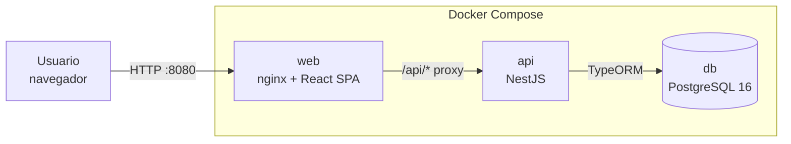
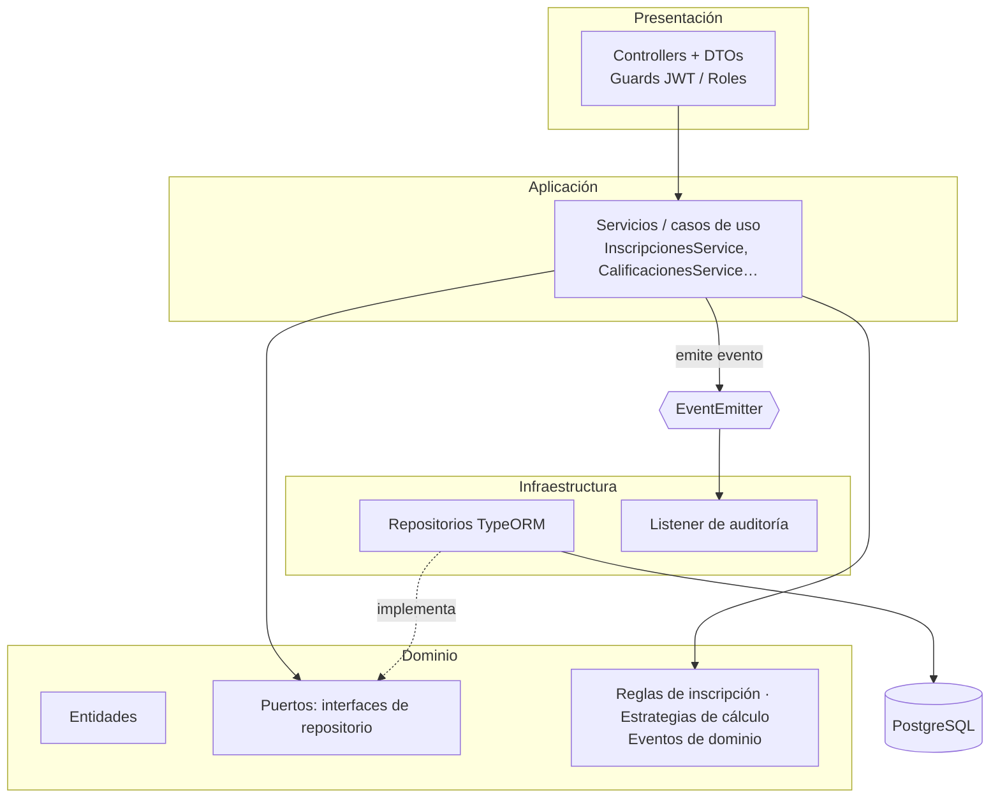
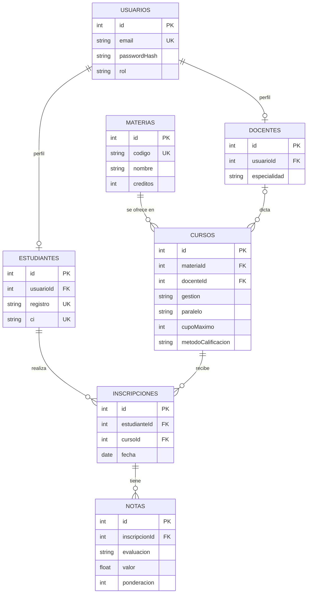

# Sistema Académico UNICEN 2026

Sistema académico con **backend (NestJS)**, **frontend (React)** y **base de datos (PostgreSQL)**, orquestado con **Docker Compose**.

Módulos:
- **Cursos y materias:** catálogo de materias y oferta de cursos por gestión (ej. `2-2026`).
- **Estudiantes e inscripciones:** registro de estudiantes e inscripción a cursos, con validación de **cupo disponible** e **inscripción duplicada**.
- **Notas y calificaciones:** registro de notas por inscripción y consulta del **historial académico**.
- **Autenticación y roles:** control de acceso con **JWT** por rol (`ADMIN`, `DOCENTE`, `ESTUDIANTE`).

---

## Cómo levantar

Requisito: Docker Desktop.

```bash
docker compose up --build
```

| Servicio | URL |
|---|---|
| Web | http://localhost:8080 |
| API | http://localhost:3000/api |
| Swagger (documentación interactiva) | http://localhost:3000/api/docs |
| PostgreSQL | `localhost:5432` (usuario/clave/BD: `unicen` / `unicen` / `sistema_academico`) |

El archivo `.env` es opcional: todas las variables tienen un valor por defecto en `docker-compose.yml`. Para cambiarlas, copiar `.env.example` como `.env`.

Al iniciar por primera vez, la API crea las tablas y carga **datos de demostración**.

### Usuarios de prueba

| Rol | Email | Contraseña |
|---|---|---|
| Administrador | `admin@unicen.edu.bo` | `Admin123*` |
| Docente | `jperez@unicen.edu.bo` | `Docente123*` |
| Docente | `mlopez@unicen.edu.bo` | `Docente123*` |
| Estudiante | `ana.garcia@unicen.edu.bo` | `Estudiante123*` |
| Estudiante | `carlos.rojas@unicen.edu.bo` | `Estudiante123*` |

> En la pantalla de login hay botones que completan estas credenciales.
> El curso **FIS100 (2-2026)** tiene cupo 1 y ya está lleno, para probar la validación de cupo.

### Desarrollo local (sin Docker para API/web)

```bash
docker compose up -d db
cd backend  && npm install && DB_HOST=localhost npm run start:dev   # API en :3000
cd frontend && npm install && npm run dev                          # Web en :5173 (proxy /api -> :3000)
```

---

## Arquitectura

### Diagrama de contenedores



nginx sirve la SPA y redirige `/api` a la API: el navegador trabaja con un solo origen (sin CORS) y la URL de la API no queda fija en el build.

### Diagrama de capas (cada módulo del backend)



### Módulos del backend

```mermaid
flowchart LR
    AUTH[auth<br/>usuarios, JWT, roles]
    CAT[catalogo<br/>materias, cursos, docentes]
    INS[inscripciones<br/>estudiantes, inscripciones]
    CAL[calificaciones<br/>notas, historial]
    AUD[auditoria<br/>suscriptor de eventos]

    CAT --> AUTH
    INS --> AUTH
    INS --> CAT
    CAL --> INS
    CAL --> CAT
    INS -. inscripcion.creada .-> AUD
    CAL -. nota.registrada .-> AUD
```

Las dependencias van en una sola dirección (sin ciclos). Auditoría no depende de nadie: solo escucha eventos.

### Modelo de datos



Restricciones únicas clave: `cursos(materiaId, gestion, paralelo)`, `inscripciones(estudianteId, cursoId)` y `notas(inscripcionId, evaluacion)`.

---

## Patrones de diseño y justificación

| Patrón | Dónde | Por qué encaja con el problema |
|---|---|---|
| **Arquitectura por capas (estilo hexagonal)** | Cada módulo: `domain/`, `application/`, `infrastructure/`, `presentation/` | Las reglas académicas (cupo, duplicados, cálculo de notas) son el corazón del sistema y no deben depender de HTTP ni de TypeORM. Los controladores solo traducen HTTP; la lógica vive en servicios y dominio. |
| **Repository** | `*.repositories.ts` (puertos) + `typeorm-*.ts` (adaptadores), enlazados con tokens de inyección | Los servicios dependen de interfaces (`InscripcionRepository`), no del ORM. Permite cambiar la persistencia o usar dobles de prueba en tests unitarios sin base de datos. |
| **Strategy (validación)** | `inscripciones/domain/reglas/` — `CupoDisponibleRegla`, `InscripcionDuplicadaRegla`, `MateriaRepetidaEnGestionRegla` | Las reglas de inscripción cambian con el reglamento (prerrequisitos, límite de créditos…). Cada regla es una clase; el caso de uso recorre la lista inyectada. Agregar una regla = crear una clase y registrarla en el módulo, sin tocar el caso de uso (abierto/cerrado). |
| **Strategy (cálculo)** | `calificaciones/domain/calculo-nota.ts` — `PromedioPonderadoStrategy`, `PromedioSimpleStrategy` | Cada curso puede evaluar distinto. El historial pide "la nota final" sin conocer la fórmula. |
| **Factory** | `CalculoNotaFactory` (elige la estrategia según `curso.metodoCalificacion`) y `UsuarioFactory` (crea usuarios con email normalizado y contraseña hasheada) | Centraliza la creación: el resto del código no hace `new` de estrategias ni repite el hasheo de contraseñas en cada módulo que registra personas. |
| **Observer** | Eventos `inscripcion.creada` y `nota.registrada` (`@nestjs/event-emitter`) → `AuditoriaListener` | Auditar es una responsabilidad transversal. Los casos de uso publican el evento sin conocer a los suscriptores; se pueden agregar notificaciones por correo o métricas sin modificarlos. Un fallo de auditoría no revierte la operación principal. |
| **Guards / decoradores (cadena de responsabilidad de Nest)** | `JwtAuthGuard` + `RolesGuard` globales, `@Publico()`, `@Roles()` | Seguridad por defecto: todo endpoint exige JWT salvo que se marque público; los permisos quedan declarados junto a cada endpoint. |

---

## Reglas de negocio implementadas

**Inscripción** (`POST /api/inscripciones`) — responde **409 Conflict** si:
1. El estudiante ya está inscrito en ese curso.
2. Ya está inscrito en otro paralelo de la misma materia en la misma gestión.
3. El curso no tiene cupo.

**Concurrencia:** la validación se ejecuta dentro de una transacción que bloquea la fila del curso (`SELECT … FOR UPDATE`). Dos inscripciones simultáneas al último cupo se serializan, así que no hay sobrecupo. Además, la restricción `UNIQUE(estudianteId, cursoId)` de la base es la última barrera contra duplicados.

**Notas:**
- Escala 0–100; se aprueba con **51**.
- Solo el **docente asignado al curso** (o un admin) puede registrar notas.
- Registrar una evaluación que ya existe la **corrige**; el evento de auditoría guarda el valor anterior.
- En cursos **ponderados**, la suma de ponderaciones no puede superar 100 %. La materia queda **cerrada** (aprobada o reprobada) cuando suman 100 %; antes figura **en curso**, con la nota parcial normalizada.
- En cursos de **promedio simple**, todas las evaluaciones pesan igual.

**Historial:** materias por gestión con sus notas, nota final, estado, promedio general (de las materias cerradas) y créditos aprobados.

---

## Permisos por rol

| Recurso | ADMIN | DOCENTE | ESTUDIANTE |
|---|---|---|---|
| Materias: ver | ✔ | ✔ | ✔ |
| Materias: crear / editar / borrar | ✔ | | |
| Cursos: ver oferta | ✔ | ✔ | ✔ |
| Cursos: crear / editar | ✔ | | |
| Docentes y estudiantes: registrar y listar | ✔ | | |
| Inscribir | a cualquier estudiante | | a sí mismo |
| Registrar notas / ver planilla | ✔ | solo sus cursos | |
| Historial | de cualquier estudiante | de cualquier estudiante | el propio |
| Auditoría | ✔ | | |

## Endpoints principales

| Método | Ruta | Descripción |
|---|---|---|
| POST | `/api/auth/login` | Login (público), devuelve `accessToken` |
| GET | `/api/auth/perfil` | Usuario del token |
| GET/POST/PATCH/DELETE | `/api/materias` | Catálogo de materias |
| GET | `/api/cursos?gestion=2-2026&materiaId=` | Oferta con cupos ocupados |
| GET | `/api/cursos/mis-cursos` | Cursos del docente |
| POST/PATCH | `/api/cursos` | Alta / edición de cursos |
| GET/POST | `/api/docentes`, `/api/estudiantes` | Registro de personas (crea usuario + perfil) |
| POST | `/api/inscripciones` | Inscribir |
| GET | `/api/inscripciones/mias`, `/api/inscripciones/curso/:id` | Consultas de inscripciones |
| POST | `/api/notas` | Registrar o corregir una nota |
| GET | `/api/notas/curso/:id` | Planilla de notas del curso |
| GET | `/api/historial/me`, `/api/historial/:estudianteId` | Historial académico |
| GET | `/api/auditoria` | Últimos eventos auditados |
| GET | `/api/health` | Estado de la API y de la BD |

Detalle completo y pruebas en **Swagger**: http://localhost:3000/api/docs (botón *Authorize* con el token del login).

---

## Estructura del repositorio

```
backend/src/
  auth/            usuarios, login JWT, guards y decoradores de roles, UsuarioFactory
  catalogo/        materias, cursos (oferta por gestión), docentes
  inscripciones/   estudiantes, inscripciones, reglas de inscripción (Strategy)
  calificaciones/  notas, historial, estrategias de cálculo + factory
  auditoria/       entidad y listener de eventos (Observer)
  seed/            datos de demostración
  shared/          tipos y utilidades comunes, health check
frontend/src/
  api/             cliente HTTP (fetch + JWT) y tipos
  auth/            contexto de sesión
  components/      layout por rol y componentes visuales
  pages/           admin/, docente/, estudiante/
docker-compose.yml
```

---

## Decisiones técnicas y concesiones

- **JWT** (no PASETO): la integración con NestJS/Passport es estándar y madura. PASETO evitaría elegir mal el algoritmo, pero agregaba riesgo para el tiempo disponible. El token dura 1 hora (`JWT_EXPIRES_IN`) y se guarda en `localStorage`. En producción convendría una cookie `httpOnly` con refresh token.
- **`synchronize: true`** en TypeORM: crea el esquema a partir de las entidades, práctico para la prueba. En producción se usarían **migraciones**.
- **Entidades del dominio con decoradores de TypeORM:** es una concesión pragmática respecto a una hexagonal "pura", que separaría el modelo de dominio del de persistencia. La dependencia del ORM sí queda aislada en los repositorios.
- **Excepciones HTTP en la capa de aplicación** (`ConflictException`, etc.) para simplificar. Con más tiempo se usarían errores de dominio propios, traducidos por un filtro de excepciones.
- **bcryptjs** (JS puro) en lugar de `bcrypt` nativo, para evitar compilar binarios en la imagen Alpine.
- **Bus de eventos en memoria:** suficiente para un solo proceso. Si se escala horizontalmente se reemplazaría por una cola (RabbitMQ, Redis Streams) o por el patrón *outbox*.

## Pendientes / mejoras posibles

- Tests unitarios de reglas y estrategias, y tests e2e de los flujos de inscripción y notas.
- Retiro de materias, edición de estudiantes y docentes, paginación de listados.
- Migraciones de TypeORM y refresh tokens.

## Uso de IA

El proyecto se desarrolló con apoyo de **Claude Code** (Anthropic) para generar el andamiaje, el código y la documentación, con revisión y pruebas manuales de los flujos principales (login, permisos por rol, cupo, duplicados, notas e historial).
